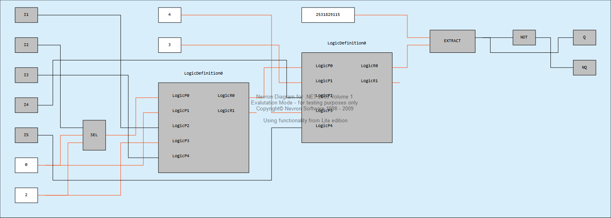

# Проверка кода допуска

Пять контактов задают номер от 0 до 31. Таблица задаёт разрешение для каждого номера. I1 соответствует младшему биту.

## Примеры строк из книги (32 записей)

| I1 | I2 | I3 | I4 | I5 | Q | NQ | Примечание |
| --- | --- | --- | --- | --- | --- | --- | --- |
| 0 | 0 | 0 | 0 | 0 | 1 | 0 |  |
| 1 | 0 | 0 | 0 | 0 | 1 | 0 |  |
| 0 | 1 | 0 | 0 | 0 | 0 | 1 |  |
| 1 | 1 | 0 | 0 | 0 | 1 | 0 |  |
| 0 | 0 | 0 | 0 | 1 | 0 | 1 |  |
| 1 | 1 | 1 | 1 | 1 | 1 | 0 |  |

Если включён только I2, код равен 2 и Q = 0. Если включить ещё I1, код равен 3 и Q = 1.

## Файлы

[Книга Excel](<Проверка кода допуска.xlsx>) · [Текст ST](CodePermit.st) · [Макрос ST](CodePermit.fbst) · [Макрос FBD](CodePermit.tple)

## Вложенные макросы

- [LogicDefinition0](CodePermit-LogicDefinition0.png)
