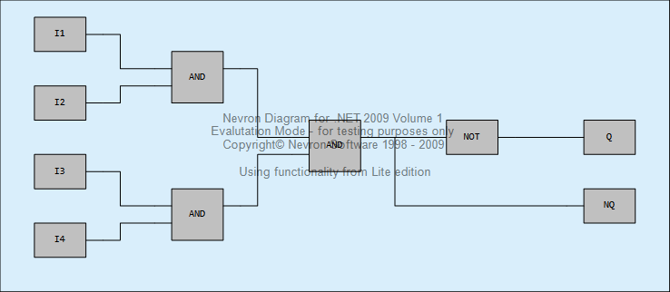

# Блокировка одного сочетания

Четыре контакта одновременно снимают разрешение. Для остальных сочетаний разрешение действует.

## Примеры строк из книги (16 записей)

| I1 | I2 | I3 | I4 | Q | NQ | Примечание |
| --- | --- | --- | --- | --- | --- | --- |
| 0 | 0 | 0 | 0 | 1 | 0 |  |
| 1 | 0 | 0 | 0 | 1 | 0 |  |
| 0 | 1 | 0 | 0 | 1 | 0 |  |
| 1 | 1 | 0 | 0 | 1 | 0 |  |
| 0 | 0 | 0 | 1 | 1 | 0 |  |
| 1 | 1 | 1 | 1 | 0 | 1 |  |

При четырёх единицах Q = 0, NQ = 1. Отключение любого контакта даёт Q = 1.

## Файлы

[Книга Excel](<Блокировка одного сочетания.xlsx>) · [Текст ST](Forbidden.st) · [Макрос ST](Forbidden.fbst) · [Макрос FBD](Forbidden.tple)

