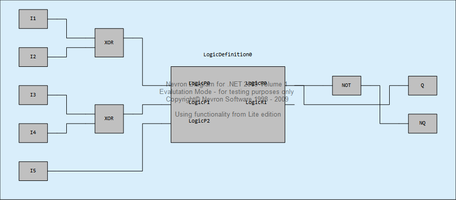

# Контроль нечётности

Прямой выход показывает, что число включённых входов нечётно.

## Примеры строк из книги (32 записей)

| I1 | I2 | I3 | I4 | I5 | Q | NQ | Примечание |
| --- | --- | --- | --- | --- | --- | --- | --- |
| 0 | 0 | 0 | 0 | 0 | 0 | 1 |  |
| 1 | 0 | 0 | 0 | 0 | 1 | 0 |  |
| 0 | 1 | 0 | 0 | 0 | 1 | 0 |  |
| 1 | 1 | 0 | 0 | 0 | 0 | 1 |  |
| 0 | 0 | 0 | 0 | 1 | 1 | 0 |  |
| 1 | 1 | 1 | 1 | 1 | 1 | 0 |  |

Один включённый вход даёт Q = 1. Два включённых входа дают Q = 0.

## Файлы

[Книга Excel](<Контроль нечётности.xlsx>) · [Текст ST](OddParity.st) · [Макрос ST](OddParity.fbst) · [Макрос FBD](OddParity.tple)

## Вложенные макросы

- [LogicDefinition0](OddParity-LogicDefinition0.png)
