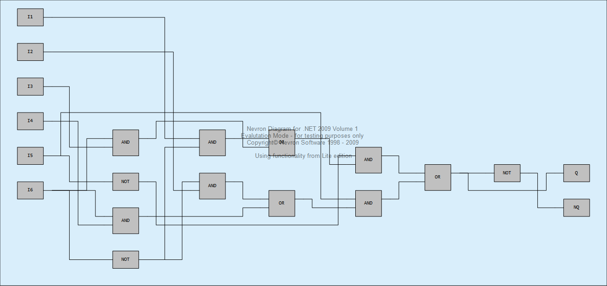

# Выбор одного из четырёх каналов

Два адресных входа выбирают, какой из четырёх сигналов поступает на выход.

## Примеры строк из книги (64 записей)

| I1 | I2 | I3 | I4 | I5 | I6 | Q | NQ | Примечание |
| --- | --- | --- | --- | --- | --- | --- | --- | --- |
| 0 | 0 | 0 | 0 | 0 | 0 | 0 | 1 |  |
| 1 | 0 | 0 | 0 | 0 | 0 | 1 | 0 |  |
| 0 | 1 | 0 | 0 | 0 | 0 | 0 | 1 |  |
| 1 | 1 | 0 | 0 | 0 | 0 | 1 | 0 |  |
| 0 | 0 | 0 | 0 | 0 | 1 | 0 | 1 |  |
| 1 | 1 | 1 | 1 | 1 | 1 | 1 | 0 |  |

При I6 = 1 и I5 = 0 выход Q повторяет I3. Остальные три канала могут иметь любое значение.

## Файлы

[Книга Excel](<Выбор одного из четырёх каналов.xlsx>) · [Текст ST](SelectChannel.st) · [Макрос ST](SelectChannel.fbst) · [Макрос FBD](SelectChannel.tple)

