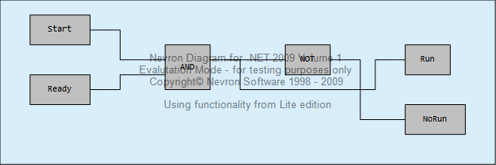

# Разрешение пуска

Команда пуска проходит при готовности привода. Для остальных сочетаний прямой выход равен нулю.

## Записи

| Start | Ready | Run | NoRun | Комментарий |
| --- | --- | --- | --- | --- |
| 1 | 1 | 1 | 0 | Пуск разрешён |

При Start = 1 и Ready = 1 выход Run = 1. При Ready = 0 выход Run = 0.

## Файлы

[Книга Excel](<Разрешение пуска.xlsx>) · [Текст ST](StartPermit.st) · [Макрос ST](StartPermit.fbst) · [Макрос FBD](StartPermit.tple)

