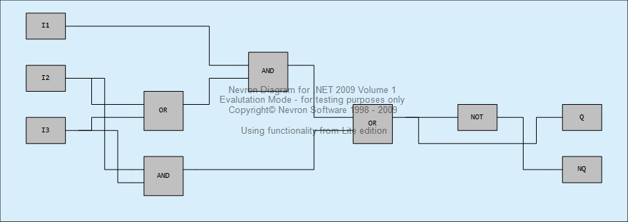

# Два датчика из трёх

Выход включается, когда сработали хотя бы два из трёх датчиков.

## Записи

| I1 | I2 | I3 | Q | NQ | Примечание |
| --- | --- | --- | --- | --- | --- |
| 0 | 0 | 0 | 0 | 1 |  |
| 1 | 0 | 0 | 0 | 1 |  |
| 0 | 1 | 0 | 0 | 1 |  |
| 1 | 1 | 0 | 1 | 0 |  |
| 0 | 0 | 1 | 0 | 1 |  |
| 1 | 0 | 1 | 1 | 0 |  |
| 0 | 1 | 1 | 1 | 0 |  |
| 1 | 1 | 1 | 1 | 0 |  |

При I1 = 1, I2 = 0 и I3 = 1 выход Q = 1. Если отключить I3, выход Q = 0.

## Файлы

[Книга Excel](<Два датчика из трёх.xlsx>) · [Текст ST](Voting.st) · [Макрос ST](Voting.fbst) · [Макрос FBD](Voting.tple)

