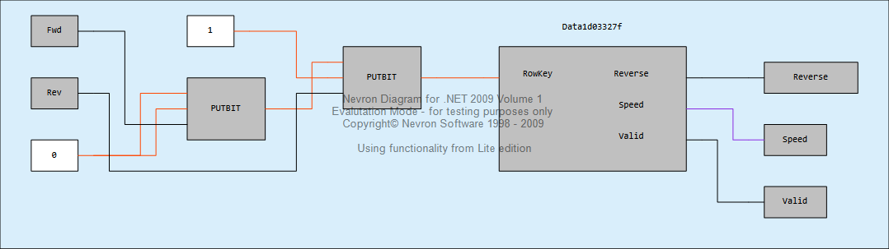

# Выбор направления

Раздельные контакты задают прямой и обратный ход. Одновременное включение обоих контактов не имеет записи.

## Записи

| Fwd | Rev | Reverse | Speed | Примечание |
| --- | --- | --- | --- | --- |
| 0 | 0 | 0 | 0 | Стоп |
| 1 | 0 | 0 | 30 | Вперёд |
| 0 | 1 | 1 | 15 | Назад |

При Fwd = 0 и Rev = 1 макрос выдаёт Reverse = 1 и Speed = 15. При Fwd = Rev = 1 выход Valid = 0.

## Файлы

[Книга Excel](<Выбор направления.xlsx>) · [Текст ST](Direction.st) · [Макрос ST](Direction.fbst) · [Макрос FBD](Direction.tple)

## Вложенные макросы

- [Data1d03327f](Direction-Data1d03327f.png)
