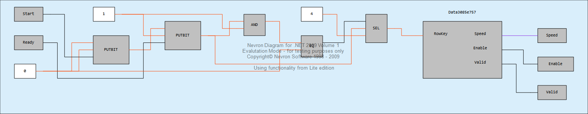

# Пуск по готовности

При снятой команде пуска состояние готовности может быть любым. Для пуска нужна готовность.

## Записи

| Start | Ready | Speed | Enable | Режим |
| --- | --- | --- | --- | --- |
| 0 | X | 0 | 0 | Останов |
| 1 | 1 | 25.5 | 1 | Работа |

При Start = 0 и Ready = 1 макрос выдаёт Speed = 0 и Valid = 1. При Start = 1 и Ready = 0 выход Valid = 0.

## Файлы

[Книга Excel](<Пуск по готовности.xlsx>) · [Текст ST](DrivePermit.st) · [Макрос ST](DrivePermit.fbst) · [Макрос FBD](DrivePermit.tple)

## Вложенные макросы

- [Data3085e757](DrivePermit-Data3085e757.png)
