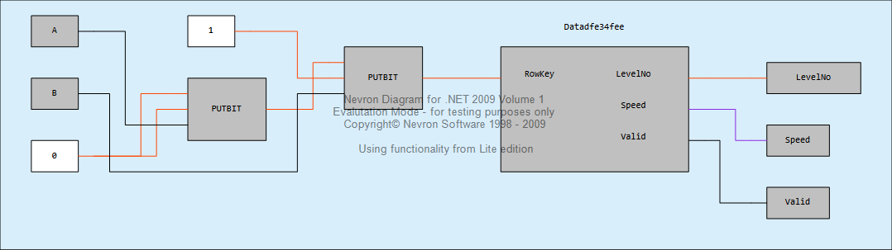

# Четыре положения переключателя

Два контакта задают положение переключателя в коде Грея. Для каждого положения заданы номер ступени и скорость.

## Записи

| A | B | LevelNo | Speed | Примечание |
| --- | --- | --- | --- | --- |
| 0 | 0 | 0 | 0 | Стоп |
| 0 | 1 | 1 | 18 | Низкая |
| 1 | 1 | 2 | 35 | Средняя |
| 1 | 0 | 3 | 50 | Высокая |

При A = 1 и B = 1 макрос выдаёт LevelNo = 2 и Speed = 35.

## Файлы

[Книга Excel](<Четыре положения переключателя.xlsx>) · [Текст ST](GraySwitch.st) · [Макрос ST](GraySwitch.fbst) · [Макрос FBD](GraySwitch.tple)

## Вложенные макросы

- [Datadfe34fee](GraySwitch-Datadfe34fee.png)
