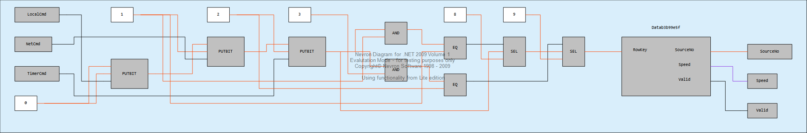

# Приоритет источника задания

Местный пост имеет приоритет над сетью. Сеть имеет приоритет над таймером. Знак X объединяет состояния младших команд.

## Записи

| LocalCmd | NetCmd | TimerCmd | SourceNo | Speed | Примечание |
| --- | --- | --- | --- | --- | --- |
| 1 | X | X | 1 | 12 | Местный |
| 0 | 1 | X | 2 | 36 | Сеть |
| 0 | 0 | 1 | 3 | 24 | Таймер |
| 0 | 0 | 0 | 0 | 0 | Нет команды |

Если включены все три команды, SourceNo = 1. При LocalCmd = 0 и NetCmd = 1 макрос выбирает SourceNo = 2 при любом TimerCmd.

## Файлы

[Книга Excel](<Приоритет источника задания.xlsx>) · [Текст ST](OrderSource.st) · [Макрос ST](OrderSource.fbst) · [Макрос FBD](OrderSource.tple)

## Вложенные макросы

- [Datab3b99e5f](OrderSource-Datab3b99e5f.png)
