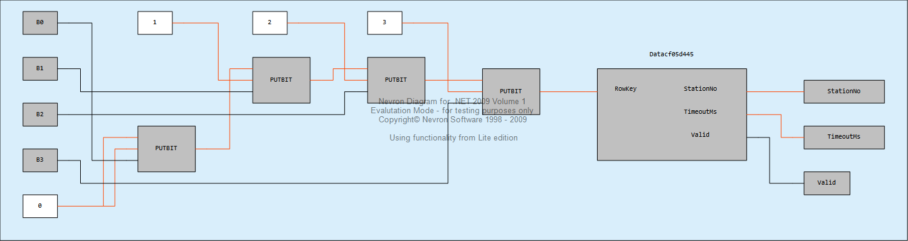

# Выбор станции по адресу

Четыре разряда задают адрес станции. Таблица хранит параметры трёх станций. B0 соответствует младшему биту.

## Записи

| B0 | B1 | B2 | B3 | StationNo | TimeoutMs | Примечание |
| --- | --- | --- | --- | --- | --- | --- |
| 1 | 0 | 0 | 0 | 101 | 250 | Станция 1 |
| 0 | 1 | 1 | 0 | 106 | 400 | Станция 6 |
| 1 | 0 | 0 | 1 | 109 | 750 | Станция 9 |

Адрес 9 выбирает StationNo = 109 и TimeoutMs = 750. При адресе 8 выход Valid = 0.

## Файлы

[Книга Excel](<Выбор станции по адресу.xlsx>) · [Текст ST](StationCode.st) · [Макрос ST](StationCode.fbst) · [Макрос FBD](StationCode.tple)

## Вложенные макросы

- [Datacf05d445](StationCode-Datacf05d445.png)
