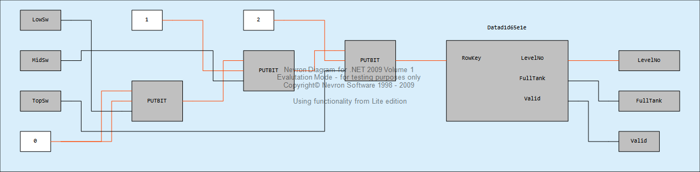

# Состояние по датчикам уровня

Три датчика расположены снизу вверх. Таблица содержит только сочетания, при которых все датчики ниже уровня жидкости включены.

## Записи

| LowSw | MidSw | TopSw | LevelNo | FullTank | Примечание |
| --- | --- | --- | --- | --- | --- |
| 0 | 0 | 0 | 0 | 0 | Пусто |
| 1 | 0 | 0 | 1 | 0 | Низкий |
| 1 | 1 | 0 | 2 | 0 | Средний |
| 1 | 1 | 1 | 3 | 1 | Полный |

Если включены нижний и средний датчики, LevelNo = 2. Один включённый верхний датчик даёт Valid = 0.

## Файлы

[Книга Excel](<Состояние по датчикам уровня.xlsx>) · [Текст ST](TankLevel.st) · [Макрос ST](TankLevel.fbst) · [Макрос FBD](TankLevel.tple)

## Вложенные макросы

- [Datad1d65e1e](TankLevel-Datad1d65e1e.png)
