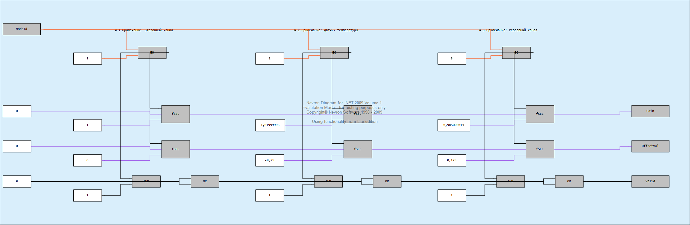

# Поправки измерительных каналов

Номер канала выбирает коэффициент и смещение для внешнего расчёта. Смещение может быть отрицательным.

## Записи

| ModeId | Gain | OffsetVal | Примечание |
| --- | --- | --- | --- |
| 1 | 1 | 0 | Эталонный канал |
| 2 | 1.02 | -0.75 | Датчик температуры |
| 3 | 0.985 | 0.125 | Резервный канал |

Для канала 2 макрос выдаёт Gain = 1,02 и OffsetVal = −0,75.

## Файлы

[Книга Excel](<Поправки измерительных каналов.xlsx>) · [Текст ST](Calibration.st) · [Макрос ST](Calibration.fbst) · [Макрос FBD](Calibration.tple)

