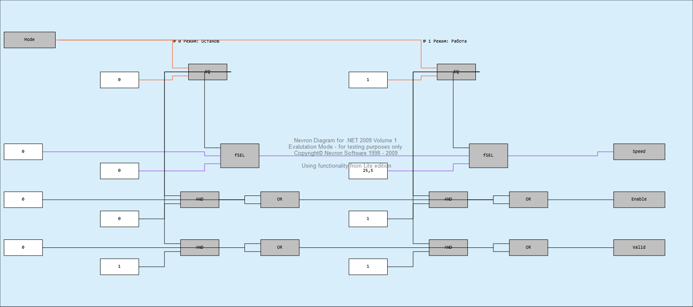

# Две скорости привода

Номер режима задаёт частоту привода и разрешение работы.

## Записи

| Mode | Speed | Enable | Режим |
| --- | --- | --- | --- |
| 0 | 0 | 0 | Останов |
| 1 | 25.5 | 1 | Работа |

При Mode = 1 макрос выдаёт Speed = 25,5 и Enable = 1. При Mode = 2 выход Valid = 0.

## Файлы

[Книга Excel](<Две скорости привода.xlsx>) · [Текст ST](DriveModes.st) · [Макрос ST](DriveModes.fbst) · [Макрос FBD](DriveModes.tple)

