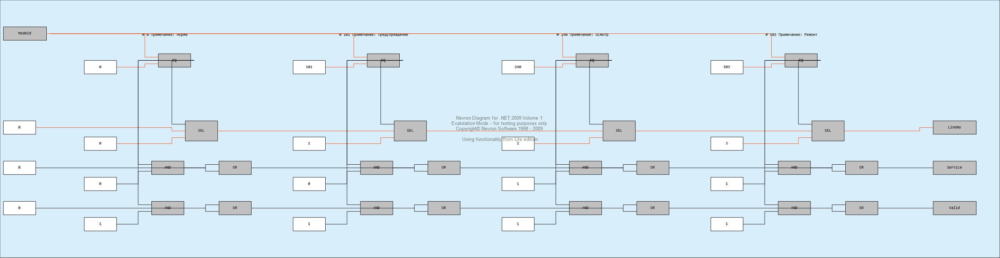

# Разреженные коды диагностики

Отдельные коды указывают канал и необходимость обслуживания. Пропуски между номерами допустимы.

## Записи

| ModeId | LineNo | Service | Примечание |
| --- | --- | --- | --- |
| 0 | 0 | 0 | Норма |
| 101 | 1 | 0 | Предупреждение |
| 240 | 2 | 1 | Осмотр |
| 503 | 3 | 1 | Ремонт |

При ModeId = 503 канал LineNo = 3. При ModeId = 502 выход Valid = 0.

## Файлы

[Книга Excel](<Разреженные коды диагностики.xlsx>) · [Текст ST](FaultCodes.st) · [Макрос ST](FaultCodes.fbst) · [Макрос FBD](FaultCodes.tple)

