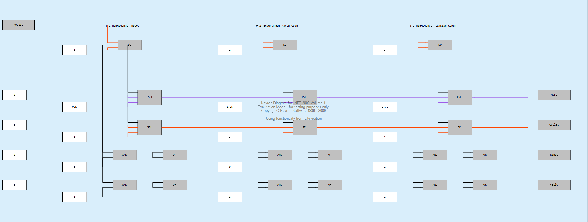

# Рецепты дозирования

Каждый рецепт задаёт массу порции, число циклов и признак промывки.

## Записи

| ModeId | Mass | Cycles | Rinse | Примечание |
| --- | --- | --- | --- | --- |
| 1 | 0.5 | 1 | 0 | Проба |
| 2 | 1.25 | 3 | 0 | Малая серия |
| 3 | 2.75 | 4 | 1 | Большая серия |

При ModeId = 3 макрос выдаёт Mass = 2,75, Cycles = 4 и Rinse = 1.

## Файлы

[Книга Excel](<Рецепты дозирования.xlsx>) · [Текст ST](Recipe.st) · [Макрос ST](Recipe.fbst) · [Макрос FBD](Recipe.tple)

