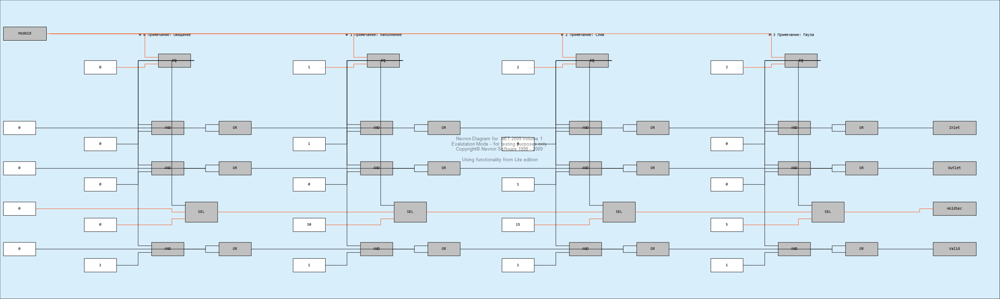

# Параметры шагов промывки

Таблица выдаёт команду на клапан и длительность выбранного шага. Номер шага подаёт внешняя программа.

## Записи

| ModeId | Inlet | Outlet | HoldSec | Примечание |
| --- | --- | --- | --- | --- |
| 0 | 0 | 0 | 0 | Ожидание |
| 1 | 1 | 0 | 30 | Наполнение |
| 2 | 0 | 1 | 15 | Слив |
| 3 | 0 | 0 | 5 | Пауза |

На шаге 2 клапан Outlet открыт на 15 секунд по уставке HoldSec. На шаге 3 оба клапана закрыты.

## Файлы

[Книга Excel](<Параметры шагов промывки.xlsx>) · [Текст ST](Sequence.st) · [Макрос ST](Sequence.fbst) · [Макрос FBD](Sequence.tple)

