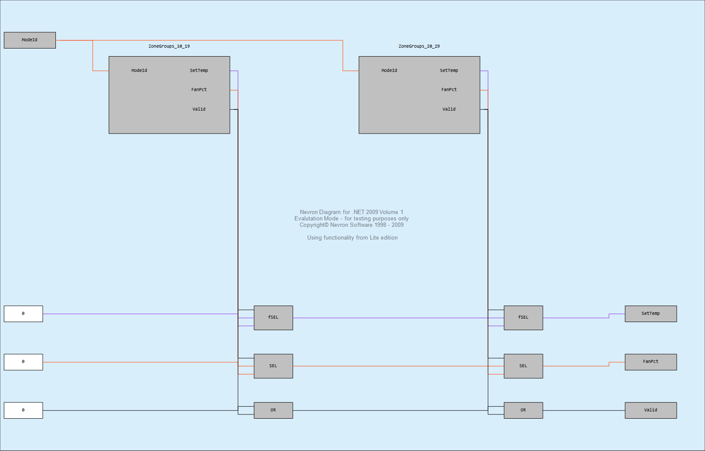

# Уставки двух зон

Десятки номера указывают зону, единицы указывают режим. В готовых макросах записи сгруппированы с шагом 10.

## Записи

| ModeId | SetTemp | FanPct | Примечание |
| --- | --- | --- | --- |
| 10 | 18 | 25 | Зона 1, ночь |
| 11 | 22 | 60 | Зона 1, день |
| 20 | 16 | 20 | Зона 2, ночь |
| 21 | 24 | 75 | Зона 2, день |

При ModeId = 21 уставка SetTemp равна 24. При ModeId = 22 выход Valid = 0.

## Файлы

[Книга Excel](<Уставки двух зон.xlsx>) · [Текст ST](ZoneGroups.st) · [Макрос ST](ZoneGroups.fbst) · [Макрос FBD](ZoneGroups.tple)

## Вложенные макросы

- [ZoneGroups_10_19](ZoneGroups-ZoneGroups_10_19.png)
- [ZoneGroups_20_29](ZoneGroups-ZoneGroups_20_29.png)
